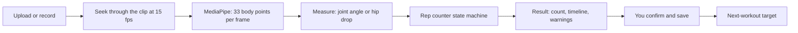

# RepCounter: how it works, what went wrong, and how to tune it

RepCounter is a website (repcounterai.com) that counts reps in a workout video. Everything runs in the visitor's browser. There is no server and no account, and the video never leaves the phone. Only a short summary of each saved set (exercise, weight, reps, effort) is stored, in the browser's own storage.

---

## 1. The tech stack

| Layer | What we use | Why |
|---|---|---|
| UI | **React 19** + **TypeScript** | Components plus type checking. `npx tsc -b` catches mistakes before they ship. |
| Build | **Vite 8** | Dev server with instant reload; bundles the site into `dist/`. |
| Styling | **Tailwind CSS v4** | Utility classes. Colors and fonts live in `src/index.css` (`@theme`). |
| Fonts | **Geist** (text) + **Newsreader** (serif headings and numbers) | Bundled with the app, so no request to Google Fonts. |
| Pose tracking | **MediaPipe Pose Landmarker (lite)** | Google's model. It finds 33 body points in an image, and runs as WebAssembly in the browser. |
| Storage | **localStorage** | The browser's built-in key-value store. Data stays on the device. |
| Tests | **Vitest** (107 unit tests), **oxlint** (lint) | `npm test`, `npm run lint`. |
| Hosting | **GitHub Pages** via GitHub Actions | Pushing to `main` runs lint, tests and the build, then publishes. |
| Install to phone | Web app manifest (PWA) | "Add to Home Screen" opens it like an app. |

---

## 2. Front to back: how a video becomes a rep count



### Step 1: Get the video (`src/video/`, `src/components/CameraStage.tsx`)
- **Upload.** The file becomes a local `blob:` URL that only this tab can see. `probeVideo.ts` reads the first and last 4 MB to find the codec, H.264 or HEVC. It only uses that to explain playback failures (for example, an HEVC clip in a browser that can't decode it).
- **Record.** `recorder.ts` uses the camera with **audio off**, so your music keeps playing. It saves MP4 when the browser can, otherwise WebM. Browser recordings often have no length in the file header, so `ensureFiniteDuration` makes the browser scan the file to find it.
- **Live framing check.** While the camera is open, `src/analysis/framing.ts` runs pose tracking about 3 times a second on a small copy of the preview. A pill at the top shows "In frame", "Step back · right wrist out of frame" or "Right elbow hidden · face the phone". It checks the exact points the chosen exercise is measured from, with the same visibility bar as counting. After a scan with poor tracking, the warning names the point that was missing most and what to change.
- **In-app browsers.** TikTok, Instagram and similar apps often block the camera. `inAppBrowser.ts` detects them and tells you to open the page in Safari or Chrome.

### Step 2: Load the pose model (`src/pose/poseLandmarker.ts`)
- The model file is `public/models/pose_landmarker_lite.task`. The WebAssembly runtime is copied from `node_modules` into `public/mediapipe/` before every dev run and build (`scripts/copy-mediapipe-wasm.mjs`), so nothing comes from a CDN.
- It tries the GPU first and falls back to the CPU.
- MediaPipe needs timestamps that always go up, so a small clock keeps them increasing even when you analyze a second clip.

### Step 3: Walk through the clip (`src/analysis/analyzeVideo.ts`)
- The video is paused, then **seeked** to every 1/15 s (about 67 ms), plus the very last frame. Seeking means the same clip always gives the same frames, which playback can't promise.
- Each frame is drawn to a canvas at most 640 px wide. The canvas applies the iPhone's rotation flag, so the model sees the frame upright.
- The model returns 33 points per frame, each with x, y and a **visibility** score from 0 to 1.
- The whole clip is scanned **once**. Switching arm or mode afterwards re-scores the saved points without scanning again.

### Step 4: Turn points into one number per frame (`src/analysis/scoreFrames.ts`)
- **Joint angle.** Take three points, for example shoulder, elbow and wrist, and measure the angle at the middle one. A curl goes from about 160° (arm straight) down to about 30° (arm bent).
- **Visibility gate.** A frame counts only if all three points have visibility ≥ **0.6**. Otherwise it is "low confidence".
- **Two sides.** For exercises that aren't per-arm (squat, press, pull-ups), both sides are measured. If both are clearly visible their values are averaged; otherwise the more visible side is used.
- **Flipped exercises.** Lateral raises and shoulder presses rest at a *small* angle, so the counter is fed `180 − angle`. The numbers in the registry stay as real angles.
- **Hip drop (squats only).** This is a percentage, not an angle. It compares your current hip-to-ankle height on screen with your standing height. Standing is about 100, parallel is about 50, and the app shows the drop as "41% hip drop". The standing height is learned from the clip and only resets if you clearly step back from the phone and stand still for a moment.

### Step 5: Count reps (`src/counting/repCounter.ts`)
A small **state machine** with three states:

```
unknown --(value reaches the "rest" line)--> extended
extended --(value passes the "rep" line)--> flexed
flexed --(back to the "rest" line)--> REP COUNTED, back to extended
```

- **Two lines, not one (hysteresis).** A curl counts at ≤ 70° bent and needs ≥ 150° straight before the next one. The gap means small wobbles near one line can't add fake reps.
- **Smoothing.** A median over 5 frames removes one-frame spikes. It lags about 2 frames.
- **Minimum rep time.** Most exercises require 0.6 s per rep, so a twitch or a step isn't counted.
- **Tracking lost.** After 10 low-confidence frames in a row (about 0.67 s), any rep in progress is thrown away, and the next rep needs a fresh start position. That timeline span is shaded amber. **The app would rather undercount than invent reps.**
- **End of clip.** If the video stops right as you return to the top, `finish()` still counts that last rep, as long as the final 2 frames are at the top.

### Thresholds per exercise (`src/exercises/registry.ts`)

| Exercise | Measures | Rep line | Rest line | Notes |
|---|---|---|---|---|
| Dumbbell curl | elbow angle, per arm | ≤ 70° | ≥ 150° | |
| Squat | hip drop | ≤ 85 (15% drop) | ≥ 90 | "Go deeper" if the bottom stays above 65 (less than a 35% drop). 0.6 s minimum. |
| Lateral raise | shoulder angle (hip–shoulder–elbow), per arm | ≥ 60° | ≤ 35° | flipped |
| Shoulder press | elbow angle, both arms | ≥ 145° | ≤ 100° | flipped |
| Pull-up | elbow angle, both arms | ≤ 90° | ≥ 140° | |
| Lat pulldown | same as pull-up | ≤ 90° | ≥ 140° | **never tested on real pulldown video** |

### Step 6: Show the result (`App.tsx`, `ResultsPanel.tsx`, `drawOverlay.ts`)
- The tracked limb is drawn over the video. The timeline has a dot per rep, and each rep chip jumps to that moment in the video.
- **Warnings:** "Pose found in X% of frames" is always shown. Below 30% the count is called unreliable.
- **Other-arm hint:** in one-arm mode, the app also scores the other arm. If that arm did the reps, it offers "Use left" or "Both arms". It never adds the other arm's reps on its own.
- **Both arms:** each arm has its own counter, so alternating curls work. Uneven sets are called out.
- You can correct the count with − and +, and nothing is saved until you press Save.

### Step 7: Save and set the next target (`src/storage/`, `src/progression/progression.ts`)
- Sets go to localStorage. Sets of one exercise saved the same day are **one workout**.
- **Target rules (reps first, then weight).** They use the last workout's sets at its heaviest weight, so warm-ups don't count:
  1. Best set 3+ reps below your range: drop one weight step.
  2. Best set reached the top of the range, none marked Failed: add one weight step and restart at the bottom.
  3. At the top but a set was Failed: same weight, aim for the top again.
  4. Otherwise: same weight, one more rep than your best set.
- The default range is **5–8**, editable per exercise. The History tab shows the last workout as a bar chart against the range.

### Privacy
- **The only outside request MediaPipe makes is a usage report** (task type, OS, timings, no video). The page's security policy blocks it.
- **Production uses a strict security policy.** The page may only load scripts, styles, fonts, images and media from its own site, plus `blob:` for your video. WebAssembly is allowed, but JavaScript `eval` is not.

---

## 3. Where things live

```
src/
  App.tsx              the page: tabs, layout, state for video → result → save
  analysis/            frame walking, per-frame scoring, overlay drawing
  counting/            rep state machine, smoothing, left/right balance
  exercises/registry.ts  every exercise: points, thresholds, wording, defaults
  pose/                MediaPipe loading, angle math
  progression/         workouts and target rules
  storage/             localStorage (sets, settings, added exercises)
  video/               file probe, recorder, in-app browser detection
  share/               the share image
  components/          UI pieces (setup, results, history, target, player)
scripts/
  eval/                dataset evaluation (RepCount-A, MM-Fit)
  og-image.html, app-icon.html   sources for the preview image and icons
public/                model, sample clip, icons, manifest, robots/sitemap
.kiro/specs/rep-analyzer/manual-test-notes.md   the lab notebook: every test and result
test-videos/datasets/  (gitignored) dataset videos and cached poses, never committed
.testclips/            (gitignored) your clips plus the browser test harness scripts
```

---

## 4. What went wrong along the way, and what we learned

**Squats took five tries.** This is the biggest lesson.
1. **Knee angle:** worked on side-view stock clips.
2. **Knee angle with a looser "bent" line:** deep squats filmed from hip height only reached about 130°.
3. **Knee angle failed on your front-view clip.** Knees read 121–148° and only 1 of 6 reps counted, because from the front the knee bend is foreshortened.
4. **Hip height above the knee:** worked until your phone-on-the-floor test. With the phone low and close, "standing" read about 150 instead of 100–130, and 0 reps counted. The knee point was also misplaced.
5. **Hip drop (current):** compares hip-to-ankle height with your own standing height in the same clip, so camera angle and distance mostly cancel out. It counts all 8 recorded clips correctly. Synthetic tests then found three edge cases, each fixed:
   - Walking toward or away from the camera: the "settle" rule now re-learns standing height.
   - One-frame ankle glitches: the standing height is median-smoothed.
   - Holding the bottom for over 6 s used to turn the bottom into "standing": the standing height is now retained instead of expiring.
   - **Lesson:** measure something that is *relative to the same person in the same clip*. Absolute angles break when the camera moves.

**The last rep went missing.** A 1.8 s one-squat clip counted 0. The smoothing lags 2 frames, and the sampler skipped the final ~60 ms. Fix: always sample the last frame and add `finish()`.
- **Lesson:** people stop recording the instant they finish.

**Video formats.**
- iPhone `.mov` files store sideways pixels plus a rotation flag. Drawing to a canvas fixes it.
- HEVC doesn't play in every browser, so the app detects the codec and explains the iPhone setting ("Most Compatible").
- Browser recordings have no length in the header, so the app scans the file to find it.
- WebM recordings analyze 3× slower than MP4 (no seek index), so MP4 is preferred.

**Bench press was dropped.** On RepCount-A it counted 125 of 322 reps (5 of 29 clips exact). Tracking a person lying down jumps between frames in crowded or head-on clips, even when the model reports high visibility. It worked on clean side views, so it is waiting on your side-view clips.
- **Lesson:** a high visibility score doesn't mean the point is right.

**Leg press and leg extension were added and removed.** On your gym clip the hip and ankle points landed on your hands, because the phone was low and the sled hid your legs. The bigger MediaPipe models didn't fix it.
- **Lesson:** if the points are wrong, no threshold can fix the count.

**Tracking loss tuning.** Dropping a rep after 10 bad frames instead of 5 found 161 of 162 pull-up reps instead of 152, with squats and raises unchanged.

**A handheld, moving close-up curl clip counted 0.** Tracking was 13–16%. That is the intended behavior: warn and invent nothing.

**Deploy breakage.** After moving to the custom domain the page was white, because assets were built for `/RepCounter/`. Fix: `base: '/'`.

**Privacy surprise.** MediaPipe phones home with usage stats. We block it with the security policy.

### Latest measured accuracy
"OBO" means off by at most one rep.

| Exercise | Dataset | Exact | OBO | Reps found |
|---|---|---|---|---|
| Squat | RepCount-A, 34 clips | 20 | 25 | 348 / 389 |
| Pull-up | RepCount-A, 26 clips | 13 | 19 | 308 / 324 |
| Lateral raise | MM-Fit, 56 sets | 43 | 51 | 538 / 559 |
| Lateral raise | RepCount-A front raises, 29 | 13 | 20 | 139 / 182 |
| Shoulder press | MM-Fit, 60 sets | 50 | 60 | 594 / 598 |

RepCount-A is hard on purpose: crowded gyms, odd angles, fast reps. Your own well-framed clips count much better than these numbers suggest. They are still a small sample of real phones, though.

---

## 5. How to tune it when you send a clip where tracking goes wrong

### The loop
1. **Run your clip through the real app and save the points.**
   ```
   npm run dev -- --port 5180 --strictPort
   node .testclips/e2e.mjs path/to/clip.MOV myclip
   ```
   This counts the clip like the website does and writes `.testclips/myclip_pose.json`: every frame's 33 points.
2. **Read the trace,** meaning the measured value for each frame. Use `node .testclips/angles.mjs .testclips/myclip_pose.json` (or `JOINT=knee`). For dataset clips, use `npm run eval -- --rescore --trace <clip id>`. Watch the video next to the numbers.
3. **Diagnose using the table below.**
4. **Change one thing,** in `registry.ts` (thresholds) or `scoreFrames.ts` (how the value is measured).
5. **Check you didn't break anything else.** These run in seconds, from cached poses:
   ```
   npm run eval -- --rescore
   npm run eval -- --rescore --dataset mmfit
   npm run eval -- --rescore --set flexEnter=80,extendEnter=145   # try values without editing code
   ```
   `.testclips/sweep.mjs` tries a whole grid of values and ranks them. Tune on the *validation* split and confirm on *test*, so you don't fit one set of clips.
6. **Lock it in with a test.** Save the clip's points as a fixture under `src/counting/__fixtures__/` (points only, never video), and add a test with the true count. Existing examples include `user-squat-phone-low`, `alternating-curl-front` and `moving-camera-closeup`.
7. **Write it down** in `manual-test-notes.md`: what failed, what changed, the numbers before and after.

### What the trace tells you

| What you see | Likely cause | Fix |
|---|---|---|
| Value never gets past the rep line on real reps (e.g. curls bottom at 80°, line at 70°) | Line too strict for this camera angle | Loosen the rep line a little, then check the datasets for new false reps |
| Value doesn't return to the rest line between reps (you don't fully stand or straighten) | Rest line too strict | Lower it, but keep a gap from the rep line, or jitter adds reps |
| Extra reps from wobble at the top or bottom | Lines too close together, or noisy points | Widen the gap, raise the 0.6 s minimum, or smooth more |
| Many `?` or low-confidence frames, "Pose found in 20%" | Framing: body part out of frame, blocked, dark, moving phone | **Don't tune.** Better filming tips, or log by hand |
| Points visibly on the wrong body part (ankle on your hand) | Model limit for this setup | No threshold fixes this. Change the measure, or don't support that setup |
| First rep missing | Clip starts mid-rep; the counter needs a start position first | Expected. Start recording before the first rep |
| Numbers look right but shift with camera angle | Absolute measure | Use a relative measure, like hip drop |

**Rule of thumb:** fix the measurement before the thresholds, and fix the thresholds before adding special cases. Every change is checked against the datasets, not just the one clip that failed.

---

## 6. This audit: what I checked and fixed

Checks now: type check clean, **lint 0 warnings** (was 6), 107 tests pass, build passes, `npm audit` reports 0 vulnerabilities.

**Fixed**
- **A cancelled scan could still show a result.** If you cancelled or removed the video during the last frame, a result for the removed video could appear. It now stops properly, and an older run can't clear a newer run's state.
- **The sample clip could replace your own clip.** If you uploaded or recorded while the sample was downloading, the sample would replace your clip and auto-count. Slow work for an old clip (codec probe, length scan) is now ignored once the clip changes.
- **History tab locked during a scan.** Switching tabs mid-scan used to unmount the video being scanned.
- **Weight checked on save too,** not only by the disabled button. An empty field could have saved as "bodyweight".
- **Corrupted saved data can't crash the app.** Bad entries in saved sets or settings are skipped. Before, one bad date could white-screen History.
- **Stricter security policy in production,** verified on the built site: pose tracking loads, nothing is blocked, and there are no outside requests.
- **Deploy permissions.** The build job, which installs third-party packages, no longer has publish rights; only the deploy step does. Lint now runs in CI too.
- **Cleanup.**
  - Removed an unused icon, an unused color and the unused Inter font package.
  - Moved the effort list out of a component file.
  - One shared "shallow rep" color instead of two copies.
  - History uses the same day rule as the targets.
  - Fixed the remaining lint issues.
  - Marked the old design doc as historical.

**Known, not changed (your call)**
- **Weight step has no unit.** Switching an exercise from lb to kg turns a 5 lb step into a 5 kg step. Fixing it needs a decision: convert the step, or reset it.
- **`App.tsx` is about 830 lines.** The video, analysis and cancel logic could become its own hook. It works; splitting it is for readability.
- **The browser test scripts in `.testclips/` aren't in git.** They sit in the ignored folder with your clips. I'd move the `.mjs` scripts to `scripts/e2e/` so they're versioned.
- **GitHub Pages can't send the header that stops other sites embedding the page.** Low risk: there is no login.
- **Not yet verified on real phones:** lat pulldown on real video; in-browser recording on iPhone and Android; busy gyms and mirrors.
- **Local clutter, all gitignored:** `.design/` (the mockups and my screenshot scripts), `.screenshots/`, `dist/`, `.DS_Store`. All safe to delete.
